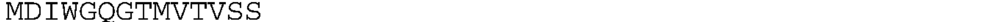
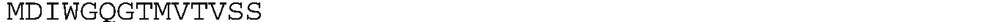
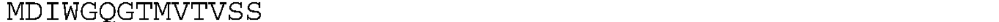
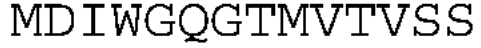
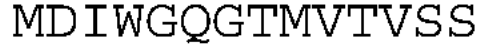

# Q 被识别成 O：实际输入图片

模型：**官方 PP-OCRv6 medium（PP-OCRv6_medium_rec）**。

**后续诊断：这三张历史输入裁图底部截掉了 Q 尾部少量像素，并保留了大量右侧空白。恢复原图底部像素或去除右侧空白后，同一模型均能正确识别，详见下方“裁图边界对照”。因此不能将这处错误单独归因于模型能力。**

以下为 WO2024020591A9 的 PDF 第196页序列表中，三条 VH 序列的**第三行实际识别输入**。直接复制实验图片，未缩放、去空白、增强或修改字符；复制后已校验与模型输入文件的 SHA-256 一致。右侧空白也是当时输入的一部分。

三张图片原文均为 `MDIWGQGTMVTVSS`，模型均输出 `MDIWGOGTMVTVSS`，差异在**从左往右第6个字符**：

```text
原图：MDIWGQGTMVTVSS
识别：MDIWGOGTMVTVSS
           ↑
          Q → O
```

## AB-1 / SEQ ID NO:4

实际输入尺寸：**1815 × 40 像素**。



原始识别输出：`MDIWGOGTMVTVSS`。

[查看未加工的识别记录](../try/ppocrv6_medium_results/raw/AB-1_line_3.json)

## AB-2 / SEQ ID NO:5

实际输入尺寸：**1817 × 41 像素**。



原始识别输出：`MDIWGOGTMVTVSS`。

[查看未加工的识别记录](../try/ppocrv6_medium_results/raw/AB-2_line_3.json)

## AB-5 / SEQ ID NO:8

实际输入尺寸：**1817 × 40 像素**。



原始识别输出：`MDIWGOGTMVTVSS`。

[查看未加工的识别记录](../try/ppocrv6_medium_results/raw/AB-5_line_3.json)

[完整 PP-OCRv6 medium 对照报告](../try/ppocrv6_medium_results/REPORT.md)

## 裁图边界对照

同一模型、同样 batch_size=1，对上述三条尾行做6种输入对照，共18次识别。恢复底部时，从原始第196页图片中取回额外8行像素，未人工修改 Q/O，也未生成笔画。

| 条件 | 尾行完全正确 |
|---|---:|
| 原裁图 | 0/3 |
| 只去右侧空白，保留旧底部边界 | 3/3 |
| 只在底部补8像素白边，不恢复笔画 | 0/3 |
| 从原图恢复底部8行像素，保留右侧空白 | 3/3 |
| 恢复底部并去除右侧空白 | 3/3 |
| 恢复底部、去除右侧空白，再四周补8像素白边 | 3/3 |

原 AB-1 裁图为1815 × 40像素，但文字只占约462像素宽，底部最后一行仍有黑色笔画。检查原始大图发现，旧裁剪边界下方还有44个前景像素被遗漏。

下面是恢复底部、去掉右侧空白后的实际输入；模型输出均为 **`MDIWGQGTMVTVSS`**。

AB-1：



AB-2：



AB-5：


[完整裁图边界对照报告及逐图输出](../try/crop_boundary_results/REPORT.md)
