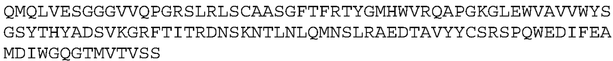
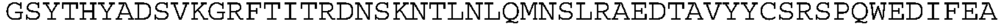
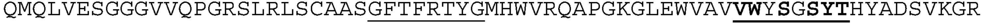

# PPVL 序列裁图识别实验

样本：WO2024020591A9 的 AB-1、AB-2、AB-5，覆盖 PDF 第 196、229、230 页。

参考序列为本次助手根据原始图片核读的暂定转录，尚非独立人工金标准。旧 OCR 和历史修复结果没有用作参考答案。

已完成 47/47 次本地 PPVL 调用；推理耗时累计 177.7 秒。

## 当前观察

在这三个诊断样本中，裁切能减少部分错误，但已测试条件均未得到整条完全一致的结果。单条三行裁图的默认识别在三条序列同一位置将 Q 识别成 O；提高视觉像素预算并未稳定改善。不能将本结果外推为整个专利的准确率。

第196页原始整表及两幅侧向比对图已用同一现有权重重新识别，输出重现了原缓存中的问题。转正后的整幅 FIG.2B 还出现了抗体行名与 SEQ ID 的错配：原始输出中 AB-1 行附带 SEQ ID NO:3，因此单纯转正整图也不能保证关系正确。

| 方式 | 整条完全一致 | 编辑距离合计 | CER | 已完成样本 |
|---|---:|---:|---:|---:|
| 旧缓存：第196页整表 | 0/3 | 5 | 1.37% | 3/3 |
| 旧缓存：两幅侧向比对图整图拼接 | 0/3 | 14 | 3.83% | 3/3 |
| 本次重跑：第196页原始整表 | 0/3 | 5 | 1.37% | 3/3 |
| 本次重跑：两幅侧向比对图整图拼接 | 0/3 | 14 | 3.83% | 3/3 |
| 两幅图转正后整图识别、按名称拼接 | 0/3 | 25 | 6.83% | 3/3 |
| 单条三行序列裁图，OCR提示，默认像素预算 | 0/3 | 3 | 0.82% | 3/3 |
| 单条三行序列裁图，表格提示，默认像素预算 | 0/3 | 3 | 0.82% | 3/3 |
| 单条序列裁图，OCR提示，最少501760像素 | 0/3 | 5 | 1.37% | 3/3 |
| 单条序列裁图，OCR提示，最少1003520像素 | 0/3 | 7 | 1.91% | 3/3 |
| 三行分别识别再拼接，默认像素预算 | 0/3 | 4 | 1.09% | 3/3 |
| 三行分别识别再拼接，最少501760像素 | 0/3 | 12 | 3.28% | 3/3 |
| 两幅图分别裁出同一序列再拼接，默认像素预算 | 0/3 | 10 | 2.73% | 3/3 |
| 两幅图分别裁出同一序列再拼接，最少501760像素 | 0/3 | 6 | 1.64% | 3/3 |

CER = Levenshtein 编辑距离 / 参考序列字符数；每组参考共366个氨基酸。FR/RF 次序交换可计为两次编辑，编辑距离不等同于不同位置的数量。HTML、换行和已知 LaTeX 下划线排版标记会被确定性移除，但字符 O 不会被改成 Q。


## 逐条结果

### archived_table_p196 / AB-1

完全一致：False；编辑距离：1；长度：121 / 122。

```text
QMQLVESGGGVVQPRSLRLSCAASGFTFRTYGMHWVRQAPGKGLEWVAVVWYSGSYTHYADSVKGRFTITRDNSKNTLNLQMNSLRAEDTAVYYCSRSPQWEDIFEAMDIWGQGTMVTVSS
```

- 参考位置 15 附近：`G` → `(空)`。

### archived_figures_p229_230 / AB-1

完全一致：False；编辑距离：5；长度：122 / 122。

```text
QMQLVESGGGVVQPGRSLRLSCAASGFTRFTYGMHWVRQAPGKGLEWVAVVWYSGSYTHYADSVKGRFTITRDNSKNTLNQLMNSLRAEDTAVYYCGRSPQWEDIFEAMDIWGQGTMVTVSS
```

- 参考位置 29 附近：`(空)` → `R`。
- 参考位置 30 附近：`R` → `(空)`。
- 参考位置 81 附近：`(空)` → `Q`。
- 参考位置 82 附近：`Q` → `(空)`。
- 参考位置 97 附近：`S` → `G`。

### rerun_original_table_p196 / AB-1

完全一致：False；编辑距离：1；长度：121 / 122。

```text
QMQLVESGGGVVQPRSLRLSCAASGFTFRTYGMHWVRQAPGKGLEWVAVVWYSGSYTHYADSVKGRFTITRDNSKNTLNLQMNSLRAEDTAVYYCSRSPQWEDIFEAMDIWGQGTMVTVSS
```

- 参考位置 15 附近：`G` → `(空)`。

### rerun_original_figures_table_prompt / AB-1

完全一致：False；编辑距离：5；长度：122 / 122。

```text
QMQLVESGGGVVQPGRSLRLSCAASGFTRFTYGMHWVRQAPGKGLEWVAVVWYSGSYTHYADSVKGRFTITRDNSKNTLNQLMNSLRAEDTAVYYCGRSPQWEDIFEAMDIWGQGTMVTVSS
```

- 参考位置 29 附近：`(空)` → `R`。
- 参考位置 30 附近：`R` → `(空)`。
- 参考位置 81 附近：`(空)` → `Q`。
- 参考位置 82 附近：`Q` → `(空)`。
- 参考位置 97 附近：`S` → `G`。

### upright_full_figures_table_prompt / AB-1

完全一致：False；编辑距离：13；长度：123 / 122。

```text
QMQLVESGGGVVQPGRSLRLSCAASGFTFRTYGMHWVRQAPGKGLEWVAVIWYDGSNKHYADSVKGRFTITRDNSKNTLNQLMNSLRAEDTAVYYCARAPQWELVVHEAFDIWGQGTMVTVSS
```

- 参考位置 51 附近：`V` → `I`。
- 参考位置 54 附近：`S` → `D`。
- 参考位置 57 附近：`YT` → `NK`。
- 参考位置 81 附近：`(空)` → `Q`。
- 参考位置 82 附近：`Q` → `(空)`。
- 参考位置 97 附近：`S` → `A`。
- 参考位置 99 附近：`S` → `A`。
- 参考位置 104 附近：`DIF` → `LVVH`。
- 参考位置 109 附近：`M` → `F`。

### sequence_block_p196_ocr_prompt / AB-1

完全一致：False；编辑距离：1；长度：122 / 122。

```text
QMQLVESGGGVVQPGRSLRLSCAASGFTFRTYGMHWVRQAPGKGLEWVAVVWYSGSYTHYADSVKGRFTITRDNSKNTLNLOMNSLRAEDTAVYYCSRSPQWEDIFEAMDIWGQGTMVTVSS
```

- 参考位置 82 附近：`Q` → `O`。

### sequence_block_p196_table_prompt / AB-1

完全一致：False；编辑距离：1；长度：122 / 122。

```text
QMQLVESGGGVVQPGRSLRLSCAASGFTFRTYGMHWVRQAPGKGLEWVAVVWYSGSYTHYADSVKGRFTITRDNSKNTLNLOMNSLRAEDTAVYYCSRSPQWEDIFEAMDIWGQGTMVTVSS
```

- 参考位置 82 附近：`Q` → `O`。

### sequence_block_p196_ocr_min501760 / AB-1

完全一致：False；编辑距离：2；长度：123 / 122。

```text
QMQLVESGGGVVQPGRSLRLLSCAASGFTFRTYGMHWVRQAPGKGLEWVAVVWYSGSYTHYADSVKGRFTITRDNSKNTLNLOMNSLRAEDTAVYYCSRSPQWEDIFEAMDIWGQGTMVTVSS
```

- 参考位置 20 附近：`(空)` → `L`。
- 参考位置 82 附近：`Q` → `O`。

### sequence_block_p196_ocr_min1003520 / AB-1

完全一致：False；编辑距离：2；长度：123 / 122。

```text
QMQLVESGGGVVQPGRSLRLLSCAASGFTFRTYGMHWVRQAPGKGLEWVAVVWYSGSYTHYADSVKGRFTITRDNSKNTLNLOMNSLRAEDTAVYYCSRSPQWEDIFEAMDIWGQGTMVTVSS
```

- 参考位置 20 附近：`(空)` → `L`。
- 参考位置 82 附近：`Q` → `O`。

### physical_lines_p196_ocr_prompt / AB-1

完全一致：False；编辑距离：2；长度：123 / 122。

```text
QMQLVESGGGVVQPGRSLRLLSCAASGFTFRTYGMHWVRQAPGKGLEWVAVVWYSGSYTHYADSVKGRFTITRDNSKNTLNLOMNSLRAEDTAVYYCSRSPQWEDIFEAMDIWGQGTMVTVSS
```

- 参考位置 20 附近：`(空)` → `L`。
- 参考位置 82 附近：`Q` → `O`。

### physical_lines_p196_ocr_min501760 / AB-1

完全一致：False；编辑距离：3；长度：124 / 122。

```text
QMQLVESGGGVVQPGRSLRLSCAASGFTFRTYGMHWVRQAPGKGLEWVAVVWYSGSYTHYADSVKGREFTITTRDNSKNTLNLOMNSLRAEDTAVYYCSRSPQWEDIFEAMDIWGQGTMVTVSS
```

- 参考位置 68 附近：`(空)` → `E`。
- 参考位置 71 附近：`(空)` → `T`。
- 参考位置 82 附近：`Q` → `O`。

### sequence_crops_figures_ocr_prompt / AB-1

完全一致：False；编辑距离：3；长度：124 / 122。

```text
QMQLVESGGGVVQPGRSLRLLSCAASGFTFRTYGMHWVRQAPGKGLEWVAVVWYSGSYTHYADSVKGGRFTITRDNSKNTLNLOMNSLRAEDTAVYYCSRSPQWEDIFEAMDIWGQGTMVTVSS
```

- 参考位置 20 附近：`(空)` → `L`。
- 参考位置 67 附近：`(空)` → `G`。
- 参考位置 82 附近：`Q` → `O`。

### sequence_crops_figures_ocr_min501760 / AB-1

完全一致：False；编辑距离：1；长度：123 / 122。

```text
QMQLVESGGGVVQPGRSLRLLSCAASGFTFRTYGMHWVRQAPGKGLEWVAVVWYSGSYTHYADSVKGRFTITRDNSKNTLNLQMNSLRAEDTAVYYCSRSPQWEDIFEAMDIWGQGTMVTVSS
```

- 参考位置 20 附近：`(空)` → `L`。

### archived_table_p196 / AB-2

完全一致：False；编辑距离：3；长度：121 / 122。

```text
QMQLVESGGGVVQPRSLRLSCAASGFTFRTYGMHWVRQAPGKGLEWVAVVWYDSGYTHYADSVKGRFTITRDNSKNTLNLQMNSLRAEDTAVYYCARSPQWEEIFEAMDIWGQGTMVTVSS
```

- 参考位置 15 附近：`G` → `(空)`。
- 参考位置 55 附近：`(空)` → `S`。
- 参考位置 56 附近：`S` → `(空)`。

### archived_figures_p229_230 / AB-2

完全一致：False；编辑距离：4；长度：122 / 122。

```text
QMQLVESGGGVVQPGRSLRLSCAASGFTRFTYGMHWVRQAPGKGLEWVAVVWYDGSYTHYADSVKGRFTITRDNSKNTLNQLMNSLRAEDTAVYYCARSPQWEEIFEAMDIWGQGTMVTVSS
```

- 参考位置 29 附近：`(空)` → `R`。
- 参考位置 30 附近：`R` → `(空)`。
- 参考位置 81 附近：`(空)` → `Q`。
- 参考位置 82 附近：`Q` → `(空)`。

### rerun_original_table_p196 / AB-2

完全一致：False；编辑距离：3；长度：121 / 122。

```text
QMQLVESGGGVVQPRSLRLSCAASGFTFRTYGMHWVRQAPGKGLEWVAVVWYDSGYTHYADSVKGRFTITRDNSKNTLNLQMNSLRAEDTAVYYCARSPQWEEIFEAMDIWGQGTMVTVSS
```

- 参考位置 15 附近：`G` → `(空)`。
- 参考位置 55 附近：`(空)` → `S`。
- 参考位置 56 附近：`S` → `(空)`。

### rerun_original_figures_table_prompt / AB-2

完全一致：False；编辑距离：4；长度：122 / 122。

```text
QMQLVESGGGVVQPGRSLRLSCAASGFTRFTYGMHWVRQAPGKGLEWVAVVWYDGSYTHYADSVKGRFTITRDNSKNTLNQLMNSLRAEDTAVYYCARSPQWEEIFEAMDIWGQGTMVTVSS
```

- 参考位置 29 附近：`(空)` → `R`。
- 参考位置 30 附近：`R` → `(空)`。
- 参考位置 81 附近：`(空)` → `Q`。
- 参考位置 82 附近：`Q` → `(空)`。

### upright_full_figures_table_prompt / AB-2

完全一致：False；编辑距离：6；长度：123 / 122。

```text
QMQLVESGGGVVQPGRSLRLSCAASGFTFRTYGMHWVRQAPGKGLEWVAVVWYSGSYTHHYADSVKGRFTITRDNSKNTLNQLMNSLRAEDTAVYYCSRSPQWEDIFEAMDIWGQGTMVTVSS
```

- 参考位置 54 附近：`D` → `S`。
- 参考位置 59 附近：`(空)` → `H`。
- 参考位置 81 附近：`(空)` → `Q`。
- 参考位置 82 附近：`Q` → `(空)`。
- 参考位置 97 附近：`A` → `S`。
- 参考位置 104 附近：`E` → `D`。

### sequence_block_p196_ocr_prompt / AB-2

完全一致：False；编辑距离：1；长度：122 / 122。

```text
QMQLVESGGGVVQPGRSLRLSCAASGFTFRTYGMHWVRQAPGKGLEWVAVVWYDGSYTHYADSVKGRFTITRDNSKNTLNLOMNSLRAEDTAVYYCARSPQWEEIFEAMDIWGQGTMVTVSS
```

- 参考位置 82 附近：`Q` → `O`。

### sequence_block_p196_table_prompt / AB-2

完全一致：False；编辑距离：1；长度：122 / 122。

```text
QMQLVESGGGVVQPGRSLRLSCAASGFTFRTYGMHWVRQAPGKGLEWVAVVWYDGSYTHYADSVKGRFTITRDNSKNTLNLOMNSLRAEDTAVYYCARSPQWEEIFEAMDIWGQGTMVTVSS
```

- 参考位置 82 附近：`Q` → `O`。

### sequence_block_p196_ocr_min501760 / AB-2

完全一致：False；编辑距离：1；长度：123 / 122。

```text
QMQLVESGGGVVQPGRSLRLLSCAASGFTFRTYGMHWVRQAPGKGLEWVAVVWYDGSYTHYADSVKGRFTITRDNSKNTLNLQMNSLRAEDTAVYYCARSPQWEEIFEAMDIWGQGTMVTVSS
```

- 参考位置 20 附近：`(空)` → `L`。

### sequence_block_p196_ocr_min1003520 / AB-2

完全一致：False；编辑距离：2；长度：123 / 122。

```text
QMQLVESGGGVVQPGRSLRLLSCAASGFTFRTYGMHWVRQAPGKGLEWVAVVWYDGSYTHYADSVKGRFTITRDNSKNTLNLOMNSLRAEDTAVYYCARSPQWEEIFEAMDIWGQGTMVTVSS
```

- 参考位置 20 附近：`(空)` → `L`。
- 参考位置 82 附近：`Q` → `O`。

### physical_lines_p196_ocr_prompt / AB-2

完全一致：False；编辑距离：1；长度：122 / 122。

```text
QMQLVESGGGVVQPGRSLRLSCAASGFTFRTYGMHWVRQAPGKGLEWVAVVWYDGSYTHYADSVKGRFTITRDNSKNTLNLOMNSLRAEDTAVYYCARSPQWEEIFEAMDIWGQGTMVTVSS
```

- 参考位置 82 附近：`Q` → `O`。

### physical_lines_p196_ocr_min501760 / AB-2

完全一致：False；编辑距离：5；长度：126 / 122。

```text
QMQLVESGGGVVQPGRSLRLSCAASGFTFTRTYGMHWVRQAPGKGLEWVAVVWYDGSYTHYADSVKGREFTITTRDNSKNTLNLOMNSLRAEDTAVYYCARSPQWEEFIFEAMDIWGQGTMVTVSS
```

- 参考位置 30 附近：`(空)` → `T`。
- 参考位置 68 附近：`(空)` → `E`。
- 参考位置 71 附近：`(空)` → `T`。
- 参考位置 82 附近：`Q` → `O`。
- 参考位置 105 附近：`(空)` → `F`。

### sequence_crops_figures_ocr_prompt / AB-2

完全一致：False；编辑距离：4；长度：125 / 122。

```text
QMQLVESGGGVVQPGRSLRLLSCAASGFTFRTYGMHWVRQAPGKGLEWVAVVWYDGSYTHYADSVKGGRFTITRDNSKNTLNLOMNSLRAEDTAVYYCARSPQWEEEIFEAMDIWGQGTMVTVSS
```

- 参考位置 20 附近：`(空)` → `L`。
- 参考位置 67 附近：`(空)` → `G`。
- 参考位置 82 附近：`Q` → `O`。
- 参考位置 105 附近：`(空)` → `E`。

### sequence_crops_figures_ocr_min501760 / AB-2

完全一致：False；编辑距离：3；长度：125 / 122。

```text
QMQLVESGGGVVQPGRSLRLLSCAASGFTFRTYGMHWVRQAPGKGGLEWVAVVWYDGSYTHYADSVKGRFTITRDNSKNTLNLQMNSLRAEDTAVYYCARSPQWEEFIFEAMDIWGQGTMVTVSS
```

- 参考位置 20 附近：`(空)` → `L`。
- 参考位置 44 附近：`(空)` → `G`。
- 参考位置 105 附近：`(空)` → `F`。

### archived_table_p196 / AB-5

完全一致：False；编辑距离：1；长度：121 / 122。

```text
QMQLVESGGGVVQPRSLRLSCAASGFTFRTYGMHWVRQAPGKGLEWVAVVWYDGYDTHYADSVKGRFTITRDNSKNTLNLQMNSLRAEDTAVYYCSRSPQWEDIFESMDIWGQGTMVTVSS
```

- 参考位置 15 附近：`G` → `(空)`。

### archived_figures_p229_230 / AB-5

完全一致：False；编辑距离：5；长度：122 / 122。

```text
QMQLVESGGGVVQPGRSLRLSCAASGFTRFTYGMHWVRQAPGKGLEWVAVVWYDGYDTHYADSVKGRFTITRDNSKNTLNQLMNSLRAEDTAVYYCGRSPQWEDIFESMDIWGQGTMVTVSS
```

- 参考位置 29 附近：`(空)` → `R`。
- 参考位置 30 附近：`R` → `(空)`。
- 参考位置 81 附近：`(空)` → `Q`。
- 参考位置 82 附近：`Q` → `(空)`。
- 参考位置 97 附近：`S` → `G`。

### rerun_original_table_p196 / AB-5

完全一致：False；编辑距离：1；长度：121 / 122。

```text
QMQLVESGGGVVQPRSLRLSCAASGFTFRTYGMHWVRQAPGKGLEWVAVVWYDGYDTHYADSVKGRFTITRDNSKNTLNLQMNSLRAEDTAVYYCSRSPQWEDIFESMDIWGQGTMVTVSS
```

- 参考位置 15 附近：`G` → `(空)`。

### rerun_original_figures_table_prompt / AB-5

完全一致：False；编辑距离：5；长度：122 / 122。

```text
QMQLVESGGGVVQPGRSLRLSCAASGFTRFTYGMHWVRQAPGKGLEWVAVVWYDGYDTHYADSVKGRFTITRDNSKNTLNQLMNSLRAEDTAVYYCGRSPQWEDIFESMDIWGQGTMVTVSS
```

- 参考位置 29 附近：`(空)` → `R`。
- 参考位置 30 附近：`R` → `(空)`。
- 参考位置 81 附近：`(空)` → `Q`。
- 参考位置 82 附近：`Q` → `(空)`。
- 参考位置 97 附近：`S` → `G`。

### upright_full_figures_table_prompt / AB-5

完全一致：False；编辑距离：6；长度：123 / 122。

```text
QMQLVESGGGVVQPGRSLRLSCAASGFTFRTYGMHWVRQAPGKGLEWVAVVWYDGSDTHHYADSVKGRFTITRDNSKNTLNQLMNSLRAEDTAVYYCARSPQWEDIFESMDVWGQGTMVTVSS
```

- 参考位置 56 附近：`Y` → `S`。
- 参考位置 59 附近：`(空)` → `H`。
- 参考位置 81 附近：`(空)` → `Q`。
- 参考位置 82 附近：`Q` → `(空)`。
- 参考位置 97 附近：`S` → `A`。
- 参考位置 111 附近：`I` → `V`。

### sequence_block_p196_ocr_prompt / AB-5

完全一致：False；编辑距离：1；长度：122 / 122。

```text
QMQLVESGGGVVQPGRSLRLSCAASGFTFRTYGMHWVRQAPGKGLEWVAVVWYDGYDTHYADSVKGRFTITRDNSKNTLNLOMNSLRAEDTAVYYCSRSPQWEDIFESMDIWGQGTMVTVSS
```

- 参考位置 82 附近：`Q` → `O`。

### sequence_block_p196_table_prompt / AB-5

完全一致：False；编辑距离：1；长度：122 / 122。

```text
QMQLVESGGGVVQPGRSLRLSCAASGFTFRTYGMHWVRQAPGKGLEWVAVVWYDGYDTHYADSVKGRFTITRDNSKNTLNLOMNSLRAEDTAVYYCSRSPQWEDIFESMDIWGQGTMVTVSS
```

- 参考位置 82 附近：`Q` → `O`。

### sequence_block_p196_ocr_min501760 / AB-5

完全一致：False；编辑距离：2；长度：123 / 122。

```text
QMQLVESGGGVVQPGRSLRLLSCAASGFTFRTYGMHWVRQAPGKGLEWVAVVWYDGYDTHYADSVKGRFTITRDNSKNTLNLOMNSLRAEDTAVYYCSRSPQWEDIFESMDIWGQGTMVTVSS
```

- 参考位置 20 附近：`(空)` → `L`。
- 参考位置 82 附近：`Q` → `O`。

### sequence_block_p196_ocr_min1003520 / AB-5

完全一致：False；编辑距离：3；长度：122 / 122。

```text
QMOLVESGGGVVQPGRSLRLSCAASGFTFRTYGMHWVROAPGKGLEWVAVVWYDGYDTHYADSVKGRFTITRDNSKNTLNLOMNSLRAEDTAVYYCSRSPQWEDIFESMDIWGQGTMVTVSS
```

- 参考位置 3 附近：`Q` → `O`。
- 参考位置 39 附近：`Q` → `O`。
- 参考位置 82 附近：`Q` → `O`。

### physical_lines_p196_ocr_prompt / AB-5

完全一致：False；编辑距离：1；长度：122 / 122。

```text
QMQLVESGGGVVQPGRSLRLSCAASGFTFRTYGMHWVRQAPGKGLEWVAVVWYDGYDTHYADSVKGRFTITRDNSKNTLNLOMNSLRAEDTAVYYCSRSPQWEDIFESMDIWGQGTMVTVSS
```

- 参考位置 82 附近：`Q` → `O`。

### physical_lines_p196_ocr_min501760 / AB-5

完全一致：False；编辑距离：4；长度：125 / 122。

```text
QMQLVESGGGVVQPGRSLRLSCAASGFTFTRTYGMHWVRQAPGKGLEWVAVVWYDGYDTHYADSVKGREFTITTRDNSKNTLNLOMNSLRAEDTAVYYCSRSPQWEDIFESMDIWGQGTMVTVSS
```

- 参考位置 30 附近：`(空)` → `T`。
- 参考位置 68 附近：`(空)` → `E`。
- 参考位置 71 附近：`(空)` → `T`。
- 参考位置 82 附近：`Q` → `O`。

### sequence_crops_figures_ocr_prompt / AB-5

完全一致：False；编辑距离：3；长度：124 / 122。

```text
QMQLVESGGGVVQPGRSLRLLSCAASGFTFRTYGMHWVRQAPGKGLEWVAVVWYDGYDTHYADSVKGGRFTITRDNSKNTLNLOMNSLRAEDTAVYYCSRSPQWEDIFESMDIWGQGTMVTVSS
```

- 参考位置 20 附近：`(空)` → `L`。
- 参考位置 67 附近：`(空)` → `G`。
- 参考位置 82 附近：`Q` → `O`。

### sequence_crops_figures_ocr_min501760 / AB-5

完全一致：False；编辑距离：2；长度：124 / 122。

```text
QMQLVESGGGVVQPGRSLRLLSCAASGFTFRTYGMHWVRQAPGKGLEWVAVVWYDGYDTTHYADSVKGRFTITRDNSKNTLNLQMNSLRAEDTAVYYCSRSPQWEDIFESMDIWGQGTMVTVSS
```

- 参考位置 20 附近：`(空)` → `L`。
- 参考位置 58 附近：`(空)` → `T`。

## 裁图核查

图像仅作裁剪、90°转正，像素未修复、未去下划线。p196 使用现有单元格定位；两幅图使用转正后的像素行投影和人工核对的行序。

AB-1_block_ocr：



AB-1_line_1：


AB-1_line_2：



AB-1_line_3：


AB-1_figure_229：



AB-1_figure_230：


AB-1_block_ocr_px501760：


AB-1_block_ocr_px1003520：


AB-1_line_1_px501760：


AB-1_line_2_px501760：


AB-1_line_3_px501760：


AB-1_figure_229_px501760：


AB-1_figure_230_px501760：


